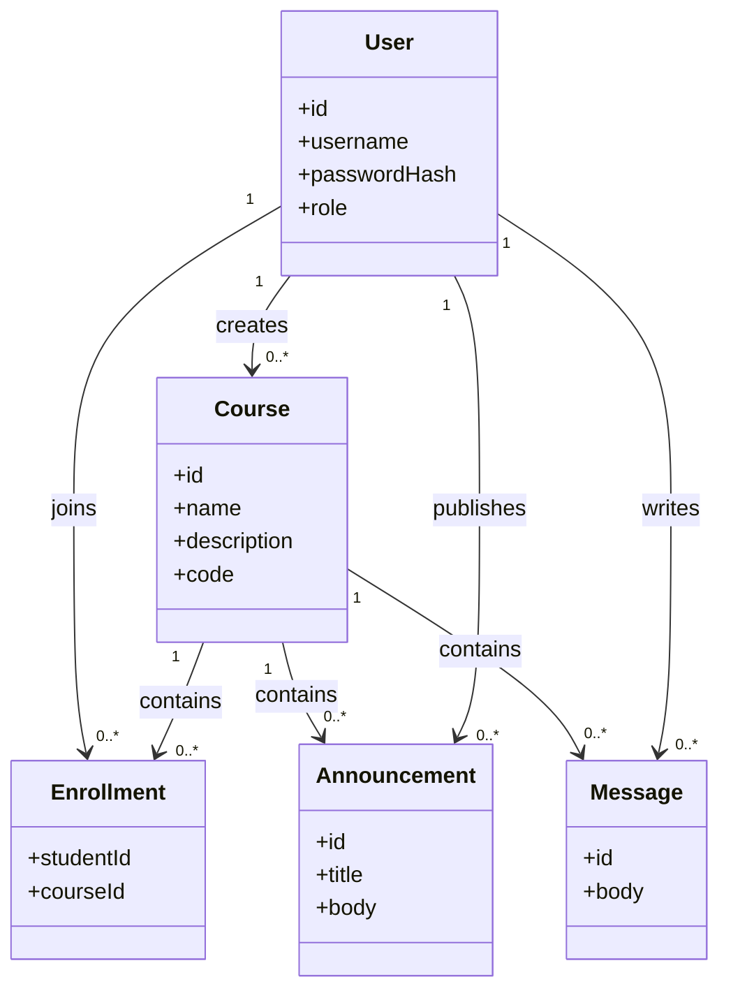
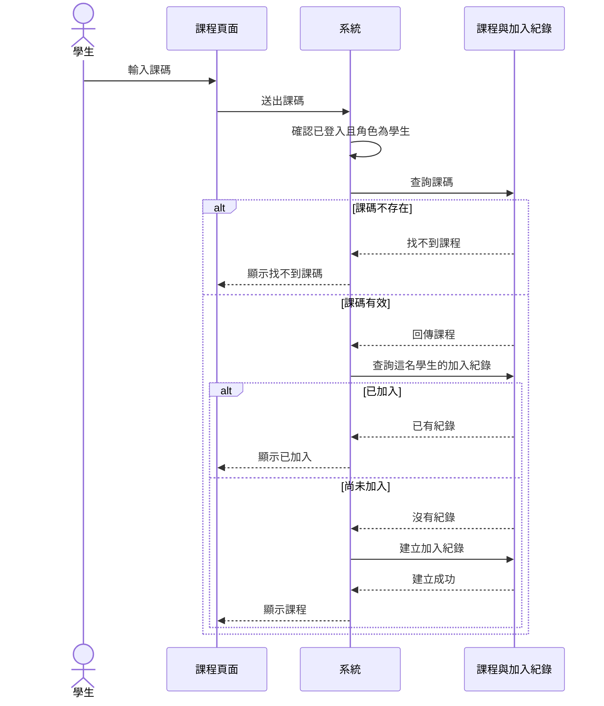

# Mini Moodle UML

版本：2026-11-06 審閱通過

依 `requirements.md` 的 R1～R5 繪製。使用者的審閱結果見 `review-02.md`。

## 類別圖

`User.role` 只有教師與學生。`Course` 的建立者是教師。`Enrollment` 連接已加入的學生與課程。同一名學生對同一門課只有一筆加入紀錄。

## 學生加入課程循序圖

這張流程圖對應 R3。課碼格式與學生角色取自 R2、R1。
